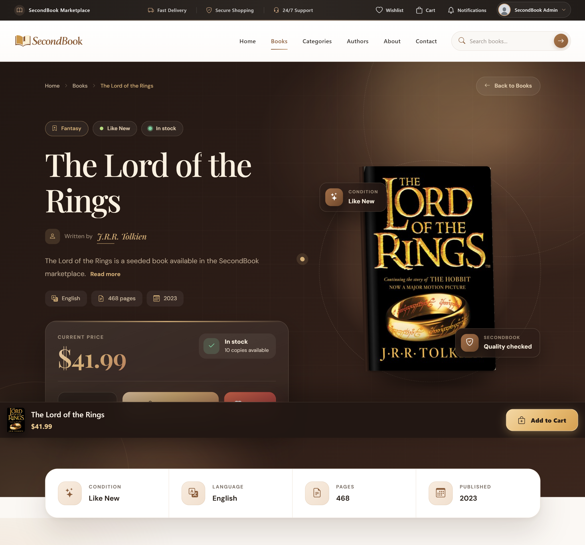

# SecondBook

SecondBook is a Laravel marketplace for discovering and trading pre-owned books. It brings a customer storefront, seller workspace, and permission-protected administration panel together in one application. The customer-facing experience is being delivered through Vue 3 pages mounted inside Laravel Blade views; the admin and seller workspaces remain Blade-rendered.

> **Project status:** Active development. This repository contains working catalog, account, cart, checkout, order, seller, and admin flows, but it is not a fully headless Vue SPA. Payment-provider processing is not configured.

## Table of Contents

- [Features](#features)
- [Technology stack](#technology-stack)
- [Application architecture](#application-architecture)
- [Roles and access](#roles-and-access)
- [Marketplace workflows](#marketplace-workflows)
- [API and browser security](#api-and-browser-security)
- [Data model](#data-model)
- [Project structure](#project-structure)
- [Requirements](#requirements)
- [Local setup](#local-setup)
- [Environment configuration](#environment-configuration)
- [Development commands](#development-commands)
- [Tests](#tests)
- [Screenshots](#screenshots)
- [Security and deployment notes](#security-and-deployment-notes)
- [Contributing](#contributing)
- [License](#license)
- [Maintainer](#maintainer)

## Features

### Customer marketplace

- Browse approved books and categories; search and filter the catalog by supported criteria.
- View book, author, publisher, and seller-store details, including stock, condition, pricing, and configured discounts.
- Maintain a wishlist, a session-backed shopping cart, and customer account preferences.
- Complete checkout with delivery/contact details and an available shipping method.
- View orders, order tracking, payment status, notifications, and submit book reviews.
- Contact the marketplace or a seller, browse FAQs and shipping/policy pages, and view current banners and blog content.
- Apply to become a seller.

### Seller workspace

Approved sellers can manage their store profile and settings, create and maintain their own book listings, review related orders and sales, see customer reviews and analytics, reply to customer messages, and manage notifications. Book ownership is checked in seller operations.

### Administration

The admin area includes dashboards and management screens for users, sellers and seller applications, books and book requests, categories, authors, publishers, book conditions, orders, payment records, refunds, shipping methods, coupons, roles and permissions, reviews, messages, banners, blog posts, FAQs, settings, email configuration, notifications, analytics, reports, activity logs, and backup operations.

The application also includes account registration and login, email/password OTP flows, account status checks, optional Google sign-in routes, session authentication, permission middleware, validation, and activity logging.

## Technology stack

| Area | Technology |
| --- | --- |
| Backend | PHP `^8.1`, Laravel `^10.10` (lockfile: 10.50.2), Eloquent ORM |
| Database | MySQL |
| Server-rendered UI | Laravel Blade |
| Interactive storefront | Vue `^3.5` (lockfile: 3.5.44) |
| Frontend build | Vite `^8.3` (lockfile: 8.3.4), Laravel Vite plugin, Vue plugin |
| Browser API client | Axios `^1.6` (lockfile: 1.20.0) |
| UI assets | Project CSS under `public/`, Bootstrap assets/CDN references, Bootstrap Icons, SweetAlert2 |
| Authentication integrations | Laravel session authentication; Laravel Socialite includes Google OAuth routes |
| PHP testing | PHPUnit 10, Laravel feature and unit tests |

The versions above describe the checked-in dependency constraints and current lockfiles. Use `composer install` and `npm ci` to install the locked dependency versions.

## Application architecture

Laravel owns routing, authentication, authorization, persistence, validation, and business workflows. `routes/web.php` serves the storefront, authentication pages, and protected Admin/Seller areas. `routes/api.php` exposes JSON endpoints used by the Vue pages as well as public catalog/content data.

### Vue and Blade

This is a **hybrid Laravel application**, not a client-side Vue Router application:

1. Laravel resolves a route and controller and renders a Blade page with the shared site layout.
2. The page provides a `data-vue-page` mount element and, when needed, data attributes for initial props.
3. `resources/js/app.js` calls `mountVuePages()`; `resources/js/mountVuePages.js` discovers `resources/js/pages/*.vue` with `import.meta.glob` and mounts the matching page.
4. Vue pages use the shared Axios client and service modules to request data from Laravel endpoints.

The mounted Vue pages cover the customer storefront and account journeys: home, books/catalog, categories, book details, authors, stores, cart, checkout, orders and tracking, payments, wishlist, reviews, notifications, account settings, authentication/profile, contact, FAQs, help, and policy/information pages. Blade remains the page shell and is also used directly for the Admin and Seller panels, email templates, errors, and some standalone authentication content. Vue shared `components/`, `composables/`, and `layouts/` directories currently contain placeholders; the page files and `services/` are the active Vue structure.

There is no Vue Router configured. The removed `/vue-test` and legacy `/catalog` demo/duplicate routes are not part of the current storefront. The real book catalog is `/frontend/books`; category browsing is `/frontend/categories`.

### Frontend data flow

`resources/js/services/api.js` creates an Axios client with `baseURL: '/api'`, credentials enabled, and XSRF-token support. Page-specific services (`accountService`, `authService`, `bookService`, `cartService`, `catalogService`, and `contentService`) wrap the relevant endpoints. Requests are same-origin and use Laravel's session cookie and web middleware; protected API routes require the authenticated session. Laravel's CSRF middleware protects state-changing web-session requests.

## Roles and access

- **User/buyer:** browses the marketplace, manages a profile and preferences, wishlist and cart, places and tracks orders, writes reviews, contacts sellers, and may apply to sell.
- **Seller:** an approved user with access to seller routes and store/book/order operations. The application checks seller role and ownership.
- **Admin:** accesses administration routes guarded by admin and permission middleware. Roles and permissions are also represented by database models and pivot relationships.

User records include an application role/status and account/profile fields. The dedicated role/permission tables support finer-grained authorization. Seller applications move through pending, approved, and rejected decisions; seller accounts have a store relationship.

## Marketplace workflows

### Catalog and sellers

Books link to categories, authors, publishers, and optionally a seller. Listings include bibliographic information, cover image, stock, condition, price, approval status, and discount settings. Admins manage and review listings; sellers manage their own listings. Stores use unique slugs and seller-specific settings such as accepting orders, processing time, and order notes.

### Cart, checkout, orders, and payments

The cart is held in the Laravel session. Checkout validates cart inventory and selected shipping/payment settings, then creates order and payment records. Orders retain customer and delivery details, shipping cost/estimate, selected method, payment status, processing details, and order status. Customers can inspect order history and tracking; sellers and admins have their respective order-management views.

**Payment limitation:** the application stores payment methods and payment/status records, but no card or PayPal gateway is configured. The payment controller explicitly leaves provider-based processing unavailable and the payment pending. Do not treat the configured credit-card, debit-card, or PayPal method labels as proof of a live payment integration. Cash on delivery is represented as a checkout option when enabled.

Shipping methods, coupons, discounts, and free-shipping/payment settings are managed through application settings. Admins can create and manage refund records and status transitions; this is an administrative refund workflow, not an integrated payment-provider refund.

### Reviews, messaging, and content

Reviews relate a user and a book and have moderation status; the `reviews` table does not have an `order_id` foreign key. Customer-to-seller messages may have multiple replies, with sender/read state. Notifications are application records with read/archive handling. Admin-managed banners, FAQs, blog posts, publishers, and shipping information can be exposed through the public content API.

### Administration and records

Admin screens include overview analytics, reports, settings, role/permission management, activity logs, and backup operations. Some historical records use an `archived_at` timestamp so the application can hide them from active lists without treating that timestamp as a database delete.

## API and browser security

API routes are prefixed by `/api` through the Laravel route service provider. Public read endpoints include:

| Endpoint | Purpose |
| --- | --- |
| `GET /api/home` | Storefront home-page data |
| `GET /api/books`, `GET /api/books/{book}` | Catalog/search and book details |
| `GET /api/categories`, `GET /api/categories/{category}` | Categories and category books |
| `GET /api/authors`, `GET /api/authors/{author}` | Authors and author books |
| `GET /api/stores/{slug}` | Public store data |
| `GET /api/faqs`, `/api/banners`, `/api/publishers`, `/api/shipping-information`, `/api/site-settings` | Public content/settings |

Session-protected routes cover authentication actions, profile/preferences, account deletion, cart and checkout, wishlist, orders/reviews, payment status, notifications, seller applications, and store messaging. Request throttles are applied to selected authentication and contact routes. The API is currently designed around the same-origin browser session; Sanctum is present as a Composer dependency, but the current route setup does not use a token-based Sanctum guard.

## Data model

Migrations in `database/migrations/` define the schema; Eloquent relationships are in `app/Models/`. Core relationships include:

```text
User ──< Book (seller_id, optional)
User ──< Order >── Book
User ──< Wishlist >── Book
User ──< Review >── Book
User ── Store (seller_id is unique)
User ──< SellerApplication
Order ── Payment
Order ──< Refund >── Payment
Order ── Shipping (optional shipping_id)
Message ──< MessageReply
Role ──< User (role_user)
Role ──< Permission (permission_role)
```

Other persisted areas include OTPs, user settings, notifications, activity logs, book metadata, coupons, FAQs, banners, blog posts, and shipping methods. Unique keys and foreign keys enforce constraints such as store slug uniqueness, one store per seller, and one wishlist entry per user/book. Review uniqueness and delete behavior should be checked against the migration history before changing the schema.

### Record fields and lifecycle

The following details reflect the current migrations and application flows. Enumerated values are persisted workflow states; they are not all independently configurable.

| Area | Current schema and behavior |
| --- | --- |
| Users and profiles | User records include `first_name`, `last_name`, unique `username` and `email`, `email_verified_at`, `role`, `status`, `profile_photo`, `phone`, `date_of_birth`, `gender`, address fields (`country`, `city`, `state`, `postal_code`, `address`), `bio`, notification/order/promotion preferences, `profile_visibility`, and `last_login_at`. Account status is `active`, `inactive`, or `banned`; gender values are `male`, `female`, and `prefer_not_to_say`. |
| Authentication and OTP | Login and registration use Laravel sessions and password hashing; Google sign-in routes use Socialite. OTP rows store email, purpose, code, expiry, and timestamps, with an `(email, purpose)` index. Code flows use email verification, password reset, password change, and account deletion purposes. OTP does not replace the session-based browser authentication model. |
| Seller applications and stores | Applications store user, store name, description, phone, address, status, rejection reason, and review time; statuses are `pending`, `approved`, and `rejected`. A store belongs to one seller and has a unique slug, profile/contact fields, and `active`/`inactive` status. Store settings include accepting orders, automatic order approval, processing time, minimum order amount, and an order note. |
| Books | Listings reference category, author, publisher, and optional seller; include title, ISBN, description, cover, publication year, page count, language, price, stock, condition, status, and discount fields. Conditions are `new`, `like_new`, `good`, and `fair`; listing statuses are `pending`, `approved`, and `rejected`. Discounts support `none`, `percentage`, and `fixed`, with value and optional start/end timestamps. |
| Orders and payments | An order stores a unique order number, user/book, book price, quantity, total, shipping fee, optional shipping method, delivery estimate, recipient name/phone/country/city/postal code/address, note, order note, processing deadline, and timestamps. Order states are `pending`, `processing`, `shipped`, `delivered`, and `cancelled`; payment states are `pending`, `paid`, `failed`, and `refunded`. Supported method values are cash on delivery, credit card, debit card, and PayPal, but external provider processing is not configured. Payment records store transaction ID, order, amount, method/status, paid time, and note. |
| Refunds | Refunds store order, optional payment, requesting user, optional processor, unique refund number, amount, reason, note, status, and requested/processed times. Statuses are `pending`, `approved`, `rejected`, `processed`, and `cancelled`. Foreign keys restrict deletion of an order or user while refunds reference them; the optional payment and processor references become null when those records are removed. |
| Reviews | A review stores user, book, rating, optional comment, status, and timestamps. Statuses are `pending`, `approved`, and `rejected`; a database unique constraint permits at most one review per user/book pair. The review table has no `order_id`; the submission flow separately checks that the customer owns a delivered order for the book. |
| Messages and replies | Messages store sender name/email, subject, body, read status (`unread` or `read`), and archive timestamp. Replies reference a message and optionally a user, store sender type and reply text, and are indexed by message and creation time. Deleting a message cascades to its replies. |
| Notifications | Notifications store an optional user reference, type, title, message, nullable `read_at`, nullable indexed `archived_at`, and timestamps. The `(user_id, read_at)` index supports account notification queries. |
| Content, coupons, and settings | Banners store copy, image, button target, position, active state, and optional display dates. Blog posts have a unique slug, excerpt/content/image, optional user author, draft/published state, and publication time. FAQs have category, question/answer, active state, and sort order. Coupons have a unique code, percentage/fixed type, value, order minimum, optional maximum discount/usage limit, usage count, validity window, and status. Settings use a unique key, indexed group, value, and type. |
| Roles, permissions, and activity | Roles and permissions have unique names and descriptive metadata. `role_user` and `permission_role` are composite-primary-key pivots. Activity logs store optional user, action, optional module, description, IP address, user agent, and timestamps; action, module, and creation time are indexed. |
| Archiving | `messages`, `orders`, `notifications`, and `reviews` have nullable indexed `archived_at` timestamps. Archiving hides historical records from applicable active views without deleting the row. |

The Admin interface includes overview, management, analytics/reporting, settings, and record-history screens. Its layout persists a light/dark theme preference and includes a responsive sidebar/navigation; responsive layouts and styles are also present in storefront and Seller views. This describes implemented UI behavior, not a guarantee that every screen has identical mobile coverage.
## Project structure

```text
app/
  Http/Controllers/{Admin,Api,Auth,Frontend,Seller}/
  Http/Middleware/
  Models/
  Services/
  Providers/
bootstrap/                 Laravel application bootstrap and cache placeholders
config/                    Laravel and service configuration
database/
  factories/                Model factories
  migrations/               Versioned schema history
  seeders/                  Development/sample data and settings
public/
  admin/                    Admin CSS, JS, and images
  frontend-assets/          Storefront CSS, scripts, fonts, and images
  seller/                   Seller CSS
resources/
  js/pages/                 Vue page entry components
  js/services/              Axios API service modules
  views/Admin/              Blade admin screens
  views/Auth/               Authentication screens
  views/Frontend/           Storefront Blade shells for Vue pages
  views/Layout/              Admin, Frontend, and Seller layouts/partials
  views/Seller/              Seller Blade screens
routes/
  web.php                   Browser routes
  api.php                   JSON API routes
  channels.php, console.php  Channel and console route definitions
storage/                    Runtime files, logs, cache, sessions, uploads
tests/                      PHPUnit feature and unit tests
```

`vendor/`, `node_modules/`, caches, and `public/build/` are generated dependencies/build output and are not source directories. Do not commit `.env` or local user uploads.

## Requirements

- PHP 8.1 or newer with the PHP extensions required by Laravel and Composer dependencies.
- Composer 2.
- MySQL and a database dedicated to this application.
- Node.js 20.19+ or 22.12+ and npm for the checked-in Vite 8 toolchain.
- Git. On Windows, Laragon is a supported local development option.

## Local setup

The commands below use PowerShell on Windows. Create the database in Laragon/phpMyAdmin first, or use your local MySQL client.

```powershell
git clone https://github.com/ElmirVelizadeDev/SecondBook.git
Set-Location SecondBook
Copy-Item .env.example .env
composer install
npm ci
```

Edit `.env` and set `APP_URL`, database name, username, and password for your local environment. The example uses `http://secondbook.test` and a local MySQL database named `secondbook`; create that database or change the values to match your Laragon setup.

```powershell
php artisan key:generate
php artisan storage:link
php artisan migrate --seed
```

`migrate --seed` creates development/sample records as well as settings and roles. `UserSeeder` defines a default local admin account for development. Review the seeder and change or remove its credentials before using a shared environment; never seed production with development defaults.

For local development, run the Laravel server and Vite in separate terminals:

```powershell
php artisan serve
```

```powershell
npm run dev
```

Open the URL printed by `artisan serve`, or use the Laragon virtual host configured in `APP_URL`. For a production asset build, run `npm run build`; the compiled manifest/assets are written to ignored `public/build/`.

## Environment configuration

`.env.example` documents the supported variables. Common local settings include:

| Variable group | Purpose |
| --- | --- |
| `APP_NAME`, `APP_ENV`, `APP_KEY`, `APP_DEBUG`, `APP_URL` | Application identity, mode, encryption key, debugging, and base URL |
| `DB_CONNECTION`, `DB_HOST`, `DB_PORT`, `DB_DATABASE`, `DB_USERNAME`, `DB_PASSWORD` | MySQL connection |
| `LOG_*`, `CACHE_DRIVER`, `SESSION_DRIVER`, `SESSION_LIFETIME`, `QUEUE_CONNECTION` | Logging and runtime services |
| `MAIL_*` | SMTP/local mail configuration for OTP and application email |
| `FILESYSTEM_DISK` | Local/public storage selection; use `php artisan storage:link` for public uploads |
| `AWS_*` | Optional S3 disk settings |
| `PUSHER_*`, `VITE_PUSHER_*` | Optional broadcast/client configuration present in the Laravel environment template |

Never copy real credentials into `.env.example`, source control, or issue reports. Use an environment-specific production `.env`, disable debug output, and configure HTTPS, mail, storage, and database credentials before deployment.

## Development commands

```powershell
# Refresh Composer autoload metadata
composer dump-autoload

# Clear Laravel's generated caches
php artisan optimize:clear

# Inspect routes (requires the application environment to boot)
php artisan route:list

# Apply new migrations
php artisan migrate

# Build production frontend assets
npm run build
```

When setting up a fresh local instance, `php artisan storage:link` may be run once. Use migrations rather than editing a live database schema manually.
Common Laravel development generators and migration helpers are also available:

```powershell
php artisan migrate:rollback
php artisan make:migration add_example_column_to_books_table
php artisan make:model Example
php artisan make:controller ExampleController
```

Use `migrate:rollback` only against the intended local/development database; it rolls back the latest migration batch. Avoid `migrate:fresh` on databases containing data.

## Tests

The PHPUnit configuration uses MySQL and forces tests to use the dedicated database `secondbook_api_test_20261016`. Create that database before running tests and verify the test configuration still points to an isolated test database; the `RefreshDatabase` tests can reset its schema/data.

```powershell
vendor/bin/phpunit
```

The suite contains feature tests for API workflows, admin access, book conditions/requests, routes/authentication, plus a small unit test. It is not a substitute for manually checking payment-provider behavior; no provider is integrated.

## Screenshots

The repository contains one non-empty, valid storefront screenshot. Other numbered screenshot files currently have zero-byte contents and are intentionally not linked here.



## Security and deployment notes

- Keep `.env`, application keys, database credentials, OAuth secrets, and user uploads private.
- Change the development seeder's default admin credential before exposing any seeded environment.
- Set `APP_DEBUG=false` in production and use HTTPS, strong database credentials, secure session settings, and a configured mail transport.
- Keep admin and seller routes behind the application's middleware and verify ownership/permission checks when adding endpoints.
- Backups and restore operations are sensitive administrative features. Store backups outside the public web root and restrict access to them.
- Payment method labels do not provide PCI-compliant card processing; integrate and test a payment provider before accepting online payments.
- Configure allowed origins deliberately if the API is ever exposed cross-origin. Current Vue requests are same-origin.

## Contributing

1. Open an issue or discussion before large architectural changes.
2. Keep changes focused and follow the existing Laravel/Vue boundaries.
3. Add or update migrations and tests when changing workflows or schema.
4. Run the relevant PHPUnit tests and `npm run build` before submitting a pull request.
5. Do not include secrets, production data, generated `vendor/`/`node_modules/`, or build output.

## License

No project-level `LICENSE` file is present in the repository. Although the root Composer manifest contains the Laravel skeleton's `MIT` metadata, confirm the maintainer's intended distribution terms before reusing or redistributing this application.

## Maintainer

**Elmir Velizade**

SecondBook is developed as a Laravel/Vue marketplace project.